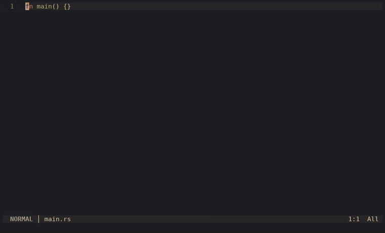

# 🦀 lsp-pet.nvim

A tiny crab that scuttles along a track while your LSP server boots and indexes.
Position = progress. When the server is ready, the crab celebrates.

<p align="center">
  
</p>

<p align="center">
  <a href="assets/demo.mp4">▶ Full-quality video (mp4)</a>
</p>

<!--
  Want GitHub's native video player instead of the GIF?
  Drag assets/demo.mp4 into the comment box of any issue/PR on this repo (don't submit it),
  copy the https://github.com/user-attachments/... URL it generates,
  and paste that URL on its own line here.
-->

```
~~~~~~~~V(o_o)V...........@
42% rust_analyzer: Indexing 120/300
```

## Features

- **Progress bar with a personality** – the crab's position follows the server's `$/progress`
  percentage; if the server reports none, it scuttles back and forth.
- **Four moods** – sleeping (server booting), working, done (`ready (12.9s)`), dead (server died).
- **Silent for fast servers** – nothing is drawn unless the server is still busy after `show_delay` ms.
- **Follows your colorscheme** – colours are read from the live theme; override any of them.
- **ASCII only** – no emoji or Nerd Font glyphs, so widths are safe everywhere (Termux included).
- **Basically free when idle** – no timer, no window, no buffer (see [Cost model](#cost-model)).

## Requirements

- Neovim **0.10+** (needs `LspProgress`, `vim.uv`, `vim.lsp.get_clients`). Developed on 0.12.
- Any LSP server that reports `$/progress` (rust-analyzer, tsserver/vtsls, lua-language-server, …).
  Servers that never report progress still get the "waking up" and "ready" poses.

## Installation

**[`vim.pack`](https://neovim.io/doc/user/pack.html) (Neovim 0.12+)**

```lua
vim.pack.add({ "https://github.com/Poarthy/lsp-pet.nvim" })
require("lsp_pet").setup()
```

**[lazy.nvim](https://github.com/folke/lazy.nvim)**

```lua
{
  "Poarthy/lsp-pet.nvim",
  event = "VeryLazy",
  opts = {},
}
```

Any other plugin manager works the same way: put the repo on the runtimepath and call
`require("lsp_pet").setup()`.

## Configuration

Everything is optional. These are the defaults:

```lua
require("lsp_pet").setup({
  enabled = true,
  width = 44,        -- float width in columns (shrinks on narrow terminals)
  frame_ms = 120,    -- animation interval
  show_delay = 300,  -- draw nothing for servers that are ready sooner than this
  grace_ms = 700,    -- keep the "working" look across gaps between consecutive progress tokens
  done_ms = 1400,    -- how long the happy crab stays
  dead_ms = 2500,    -- how long the dead crab stays
  max_ms = 120000,   -- hide after this long; a new `begin` token brings it back
  zindex = 40,
  highlights = {},   -- per-group overrides (see below)
})
```

Disable it completely at any time with `vim.g.lsp_pet = false`.

### Colours

By default the palette is derived from your colorscheme each time the window opens:

| Group             | Meaning                         | Falls back through                |
| ----------------- | ------------------------------- | --------------------------------- |
| `LspPetTrack`     | track / window background       | `Comment`                         |
| `LspPetCrab`      | working (and the path walked)   | `Orange`, `DiagnosticWarn`        |
| `LspPetCrabSleep` | server booting                  | `Grey`, `Comment`                 |
| `LspPetCrabDone`  | ready                           | `Green`, `DiagnosticOk`           |
| `LspPetCrabDead`  | server died                     | `Red`, `DiagnosticError`          |

To pin your own colours, pass any of `track`, `crab`, `sleep`, `done`, `dead`:

```lua
require("lsp_pet").setup({
  highlights = {
    crab = { fg = "#f74c00", bold = true },
    done = { link = "DiagnosticOk" },
  },
})
```

## Commands

| Command                  | Description                                                            |
| ------------------------ | ---------------------------------------------------------------------- |
| `:LspPetDemo`            | Fake boot sequence: wake up → fetching → percentages → ready           |
| `:LspPetDemo spin`       | Server that never reports a percentage (crab scuttles back and forth)  |
| `:LspPetDemo dead`       | Server that dies mid-boot                                              |

## Cost model

The design goal is to cost nothing when you are not waiting for a server.

- **Idle:** no timer, no window, no buffer. The standing cost is one `LspProgress` autocmd whose
  handler is O(1) table bookkeeping, plus a `FileType` autocmd that schedules a check which returns
  immediately unless `vim.lsp` is already loaded.
- **Active:** one libuv timer (~8 fps). A tick is one scan of `vim.lsp.get_clients()`, one
  `nvim_buf_set_lines`, and one extmark on a 2-row float. The animation phase is derived from the
  wall clock and at most one tick is ever queued, so a busy main loop cannot build a backlog.
- **Fail-safe:** any error inside a tick shuts the pet down for the rest of the session and
  shows a single warning.

## Notes

- The "sleeping" pose relies on `vim.lsp.get_clients({ _uninitialized = true })`, an internal
  option. On Neovim versions that ignore it you only lose that pose; progress, done and dead
  still work.
- The window is anchored to the bottom-right corner, just above the statusline/cmdline.

## License

[MIT](LICENSE)
